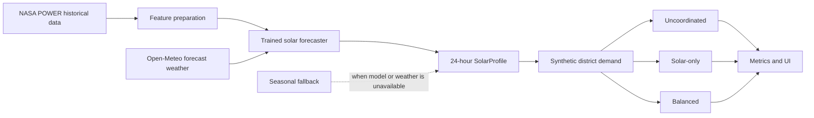

# Solar Saver

**Schedule flexible electricity use when solar energy is available—without overloading the grid or ignoring people's priorities.**

[Open the public demo](https://shamirgelal.github.io/Solar-Saver/) · [Read the project context](PROJECT_CONTEXT.md) · [Explore the forecasting pipeline](solar_saver/forecasting/README.md)

Solar Saver is a Girls Hoo Hack 2026 prototype for a simulated Charlottesville district. It predicts a 24-hour solar-supply profile, generates synthetic household demand, and compares three ways to schedule flexible loads such as EV charging, laundry, dishwashing, water heating, and battery charging.

The central question is simple: **How can a community move flexible electricity use toward solar hours without creating a new demand peak?**

> [!IMPORTANT]
> The GitHub Pages site is a static, precomputed district demo. Run the Python application locally to use **Compare my loads** with appliances you enter.

## What the program does

Solar Saver runs one reproducible 24-hour simulation:

1. A solar forecaster produces one expected supply value for each hour.
2. A deterministic demand generator creates background demand and flexible household requests.
3. Three scheduling policies receive the exact same scenario.
4. The application measures solar matching, grid energy, peak demand, completion, capacity violations, preference shifts, and unfinished work.
5. The UI displays the policies side by side and plots their hourly demand.

The current district demo models:

- **40,000 synthetic people**, represented by **16,000 households**;
- **one flexible request per household**;
- **80,000 kW of community solar capacity**;
- an **80,000 kW total-demand capacity limit**;
- 24 one-hour slots on October 18, 2026; and
- seed 42, so identical inputs produce identical scenarios.

These are explicit demonstration assumptions. The demand profile, population conversion, solar capacity, and grid limit are not observed Charlottesville utility data.

## The three scheduling policies

| Policy | How it schedules work | Trade-off it demonstrates |
| --- | --- | --- |
| **Uncoordinated** | Starts each request as close as possible to its preferred time. | Protects convenience, but does not coordinate the community. |
| **Solar-only** | Moves requests toward the strongest available solar supply while respecting windows and capacity. | Uses more solar, but may shift people farther from preferred times. |
| **Balanced** | Scores solar use, capacity, priority, preference, peak demand, and fairness together. | Seeks a practical compromise across all goals. |

Critical workload protection is an explicit scheduling rule. The ML model only predicts solar availability; it never decides which person deserves electricity.

## How the system fits together



The forecasting pipeline uses a scikit-learn histogram gradient-boosting model. At runtime, Solar Saver loads `artifacts/solar_forecaster.joblib` and requests weather inputs from Open-Meteo. If the artifact is missing or weather is unavailable, it switches to a clearly labeled deterministic seasonal fallback. Invalid artifacts and unrelated application errors remain visible as errors.

All subsystems communicate through the domain objects in [`solar_saver/domain.py`](solar_saver/domain.py) and protocols in [`solar_saver/contracts.py`](solar_saver/contracts.py). The integration entry point is [`run_comparison`](solar_saver/pipeline.py).

## Public demo versus local application

| Capability | GitHub Pages | Local Python application |
| --- | :---: | :---: |
| View the 40,000-person district comparison | Yes | Yes |
| Switch charts between the three policies | Yes | Yes |
| Inspect hourly values and metrics | Yes | Yes |
| Add or edit appliance loads | Prepare only | Yes |
| Run **Compare my loads** | No | Yes |
| Recompute forecasts and schedules | No | Yes |

GitHub Pages can serve HTML, CSS, JavaScript, and a precomputed JSON report, but it cannot run this repository's Python backend. The local application provides `POST /api/comparison`, which validates entered loads and runs the real pipeline. A future public interactive deployment will require hosting that Python API.

## Run the complete application locally

Python 3.10 or newer is recommended. Clone the repository, enter its directory, and install the dependencies in a virtual environment.

### Windows PowerShell

```powershell
py -m venv .venv
.\.venv\Scripts\python.exe -m pip install -r requirements.txt
.\.venv\Scripts\python.exe -m solar_saver.ui
```

### macOS or Linux

```bash
python3 -m venv .venv
.venv/bin/python -m pip install -r requirements.txt
.venv/bin/python -m solar_saver.ui
```

Open [http://127.0.0.1:8000](http://127.0.0.1:8000). If port 8000 is busy, add `--port 8001` to the last command and open [http://127.0.0.1:8001](http://127.0.0.1:8001). Stop the server with `Ctrl+C`.

The local page has two modes:

- **District demo** runs all 16,000 synthetic household requests.
- **My loads** lets you add, edit, and remove up to 100 appliance requests. Entered requests replace the district's generated flexible requests while the same synthetic background demand, solar capacity, and demand limit remain.

Each appliance has a power requirement, whole-hour duration, availability window, preferred start, priority, and willingness to shift. Completed work always keeps its requested energy and must remain inside its allowed window.

### Run the command-line comparison

Windows PowerShell:

```powershell
$env:PYTHONPATH = "."
.\.venv\Scripts\python.exe scripts/run_demo.py
```

macOS or Linux:

```bash
PYTHONPATH=. .venv/bin/python scripts/run_demo.py
```

The command prints the selected forecast model and any fallback warning, then outputs the metrics for all three policies as JSON.

### Run without network access or a trained artifact

Set `SOLAR_SAVER_FORECAST_MODE=demo` before starting the CLI or UI. This forces the deterministic seasonal forecaster. Use `auto` to restore trained-model selection. Dependencies still need to be installed because the forecasting package imports the ML components.

To prepare data and train a local artifact, follow the [`forecasting README`](solar_saver/forecasting/README.md). Trained artifacts, raw downloads, caches, and generated outputs are intentionally excluded from Git.

## Test the project

From the repository root:

```bash
python -m unittest discover -s tests -v
```

The suite covers shared contracts, deterministic demand generation, scheduling invariants, metrics, forecasting data and model behavior, runtime fallback, local HTTP endpoints, custom appliance inputs, and the GitHub Pages export.

## Repository guide

```text
solar_saver/
├── data/           NASA POWER, Open-Meteo, and feature preparation
├── forecasting/    seasonal fallback, trained model, and evaluation
├── demand.py       deterministic synthetic household demand
├── scheduling.py   uncoordinated, solar-only, and balanced scheduling
├── metrics.py      policy comparison metrics
├── pipeline.py     shared backend integration entry point
└── ui/             local server, browser interface, and static exporter

scripts/            data preparation, training, and CLI demo commands
tests/              unit, contract, integration, HTTP, and export tests
.github/workflows/  test and GitHub Pages deployment workflow
```

Developers and coding agents should read [`AGENTS.md`](AGENTS.md), [`PROJECT_CONTEXT.md`](PROJECT_CONTEXT.md), and the matching assignment under [`instructions/`](instructions/) before changing a subsystem.

## Current limitations

- Demand and appliance ownership are synthetic and have not been calibrated against utility or household datasets.
- The demo represents one district, one day, and hourly time slots.
- The scheduler is deterministic and greedy; it is not a globally optimal power-system dispatch model.
- Fairness is evaluated within one simulated day, not across repeated days.
- The trained forecast depends on a local artifact and live weather inputs.
- GitHub Pages publishes a seasonal-fallback result unless its build receives a trained artifact separately.
- The public site cannot run custom appliance comparisons until the Python API is deployed.
- The prototype does not control physical appliances, integrate with a utility, calculate bills, or make production reliability guarantees.

Solar Saver schedules when requested energy is used. It does not claim to reduce total energy consumption when every workload still completes. The meaningful outcomes are renewable-energy matching, grid energy, peak demand, capacity compliance, completion, and the amount of inconvenience introduced by shifting.

## GitHub Pages deployment

The workflow in [`.github/workflows/static.yml`](.github/workflows/static.yml) runs the full test suite, builds a fixed report with the real backend pipeline, and deploys only the generated static files. A failed test or backend build stops deployment instead of publishing incomplete results.

To build the same static site locally:

```bash
python -m solar_saver.ui.export --output-dir outputs/pages
python -m http.server 8002 --bind 127.0.0.1 --directory outputs
```

Then open [http://127.0.0.1:8002/pages/](http://127.0.0.1:8002/pages/).

## Team workflow

Subsystem ownership and stable boundaries are documented in [`AGENTS.md`](AGENTS.md). Keep feature branches focused, preserve the shared API, merge current `main` before opening a pull request, and run the complete suite after every subsystem merge.
